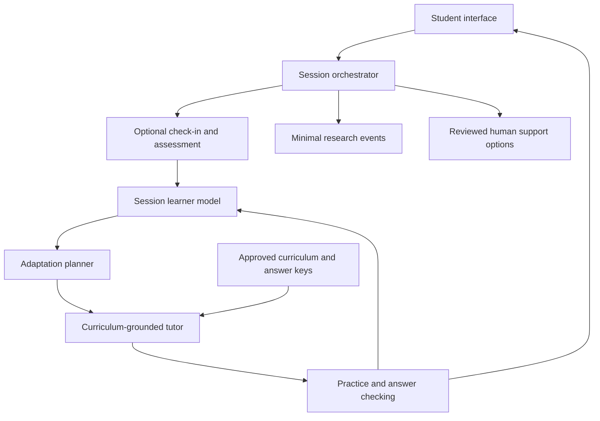

# Proposed system architecture

## Principles

Keep teaching decisions inspectable, separate evidence from inference, minimize personal data, and permit student override. A single orchestrator with separate modules is sufficient initially; multiple autonomous agents are not required.



## Module contracts

| Module | Input | Output | Failure behavior |
| --- | --- | --- | --- |
| Check-in | Goal and optional selections | Student-confirmed preferences | Permit skipping |
| Assessment | Item ID and answer | Rubric evidence and uncertainty | Clarify ambiguous answers |
| Learner model | Assessment evidence | Topic state with provenance | Avoid permanent ability labels |
| Planner | Topic state and selected barrier | Strategy, reason, next activity | Approved standard activity |
| Tutor | Approved activity and prompt version | Explanation and practice | Acknowledge uncertainty |
| Event recorder | Allowed session events | Versioned research record | Exclude free text by default |
| Support pathway | Explicit request or concerning disclosure | Reviewed support options | Never invent outreach |

## Proposed session contract

```json
{
  "schema_version": "0.1",
  "fictional": true,
  "session_id": "demo-001",
  "topic_id": "fractions-equivalence",
  "condition": "knowledge_and_barrier",
  "evidence": [{"item_id": "baseline-01", "correct": false}],
  "barrier": {"value": "pace", "source": "student_selected"},
  "strategy": "smaller_steps",
  "student_can_override": true,
  "prompt_version": "draft-01"
}
```

This contract is not implemented yet. One wrong answer is insufficient for a permanent label. Distinguish self-report, observed performance, and tentative planner hypotheses.

## Initial decision rules

- Prerequisite errors: teach the missing concept and use a fresh check.
- Pace concern: shorten the task and present one step at a time.
- Relevance concern: ask about an optional interest and use a correct example.
- Confidence concern: offer hints and low-pressure practice.
- Skipped barrier: continue using educational evidence alone.
- Rejected strategy: offer another format and respect the override.

## Implementation sequence

1. Local session runner with fixed curriculum and deterministic planning.
2. Provider-independent model adapter with timeouts and bounded retries.
3. Answer validation and content retrieval with approved source IDs.
4. Accessible interface with session reset.
5. Research export after event schema and consent decisions.

Framework, provider, hosting, storage, and authentication remain undecided. Credentials belong on the server, not in the browser or repository. Models must not have unrestricted database or messaging access. Student text and retrieved content cannot override application rules. A prompt alone is not a safety system.

Later features such as teacher review, multilingual content, and longitudinal profiles require separate designs and evaluation.
